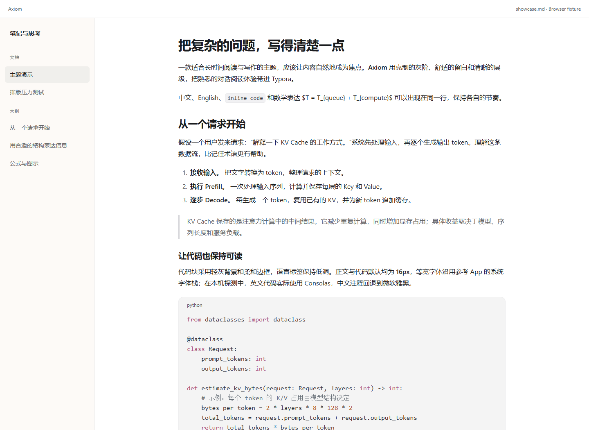

# Axiom

把熟悉的对话阅读体验，带进 Typora。

一款依据浅色 ChatGPT 外观配置设计的独立主题：白色正文、黄色强调色、暖白侧栏、柔和的代码块和清晰的中文排版。安装只需要一个 CSS 文件，离线使用，无需字体下载或插件。

> 当前版本：**0.2.0 开发预览**。已完成浏览器排版、Typora 基础样式及本机 MathJax / Mermaid 引擎的集成检查。真实 Typora 编辑交互与原生 PDF 导出仍待验证。当前样张属于浏览器开发夹具，不是 Typora 实机截图。



## 设计

- **安静的阅读区域。** 正文与代码默认 16px，正文最大可用宽度约 800px；标题、段落与列表保持清晰节奏。
- **适合技术笔记。** 覆盖中英文混排、代码、表格、引用、任务列表、目录、脚注和元数据。
- **柔和的代码样式。** 等宽字体、语言标签、低饱和语法配色，不添加装饰性窗口按钮。
- **统一的应用界面。** 为侧栏、文件树、大纲、搜索与弹窗提供对应样式。
- **可调整。** 字体、颜色、列宽、行高都通过 CSS 变量管理，尊重 Typora 的字号偏好设置。
- **单文件、离线。** 没有远程字体、脚本、追踪或资源依赖。

## 安装

1. 下载 [axiom.css](axiom.css)（在 GitHub 文件页选择下载原始文件），或解压开发预览安装包。
2. 在 Typora 中打开 **偏好设置 → 外观 → 打开主题文件夹**。
3. 将 `axiom.css` 复制进去。
4. 重启 Typora，在 **主题** 菜单中选择 **Axiom**。菜单大小写由 Typora 生成，可能因版本不同而略有差异。
5. 打开 `examples/showcase.md` 查看完整示例。

Windows 常见主题目录是 `%APPDATA%\Typora\themes`。以软件中“打开主题文件夹”实际打开的位置为准。

可选的 Windows 安装脚本：

```powershell
pwsh -File scripts/install.ps1
```

脚本只复制本项目的主题文件；覆盖已有同名文件前会创建时间戳备份，不会自动切换当前主题。

卸载时，在主题文件夹中删除 `axiom.css` 并切换其他主题即可。自行创建的 `axiom.user.css` 需单独保留或移除。

## 字体与字号

默认字体声明已按参考 App 的本机资源核对。界面与正文：`-apple-system, BlinkMacSystemFont, "Segoe UI", sans-serif`；代码：`ui-monospace, "SFMono-Regular", "SF Mono", Menlo, Consolas, "Liberation Mono", monospace`。

在本机 Windows Chrome 的字形探测中，同样的声明实际使用 **Segoe UI（英文）、Microsoft YaHei／微软雅黑（中文）、Consolas（英文代码）**。这属于本机浏览器探测证据，不是对其他设备字体的保证。

没有安装某个字体时会自动回退，因此不同设备的字形和换行会略有不同。主题不捆绑或下载商业字体。

默认根字号 16px，其余字号使用相对单位。你可以在 Typora 的偏好设置里调整字号。

## 自定义

在主题文件夹中新增 `axiom.user.css`，例如：

```css
:root {
    /* 总列宽含左右各 1.5rem 内边距；53rem 对应约 800px 正文宽度。 */
    --axiom-content-width: 53rem;
    --axiom-body-leading: 1.75;
    --axiom-code-leading: 1.5;
    --axiom-radius: 0.75rem;
}
```

可使用 `--axiom-ui-font`、`--axiom-code-font` 调整字体，使用 `--axiom-bg`、`--axiom-text`、`--axiom-subtle`、`--axiom-code-bg`、`--axiom-border` 和 `--axiom-link` 调整颜色。修改后重新加载主题或重启 Typora。

`examples/customization.user.css` 提供可复制的完整示例。

## 兼容性与验证范围

目标首先是 Windows Typora 1.9.5。macOS、Linux 和其他 Typora 版本尚未实机验证。

| 项目 | 状态 |
| :--- | :--- |
| 浏览器夹具：390 / 640 / 1024 / 1440px 布局 | 已检查，无页面级横向溢出 |
| 浏览器夹具：字体缩放到 20px | 正文与代码均随根字号变化 |
| 正文、次级文字、链接、选中文字和黄色按钮文字 | 已计算，检查项达到 4.5:1 |
| 参考 App 的 Codex 代码配色 | 已核对主要 token；字符串与属性色保留参考值，部分配对低于 4.5:1，报告明确记录 |
| 主题网络依赖 | 无；浏览器夹具未发起网络请求 |
| Typora 基础 CSS + 代表性编辑器 DOM | 已检查代码行、任务复选框、源码区域及界面状态 |
| 本机 MathJax / Mermaid 引擎的浏览器集成 | 已检查 3 种宽度，无公式解析错误及页面溢出 |
| 浏览器 A4 打印样张 | 已检查换行、表格和分页；与原生导出分开记录 |
| 真实 Typora：光标、输入、任务复选框、表格编辑 | 待验证 |
| 真实 Typora：公式、Mermaid、源码及专注模式 | 待验证 |
| 原生 HTML / PDF 导出 | 待验证 |

宽代码行保留代码块内的横向滚动；宽表格依靠 Typora 的表格容器滚动。打印样式会对长代码启用换行。复杂宽表格的打印仍需要单独检查。

常规浏览器夹具中的公式保留原始标记，Mermaid 用本项目绘制的 SVG 占位，代码高亮与侧栏是模拟结构。另有可选集成检查，读取本机 Typora 的基础 CSS、MathJax 和 Mermaid 引擎；这些本机资源只保存在忽略的开发目录中，不进入安装包或仓库。以上检查均不能证明原生编辑交互已经通过。

## 开发

Node.js 20+、Python 3.10+。

```sh
npm install
npx playwright install chromium
npm run preview
npm run capture
npm run check
npm run build
```

有本机 Typora 安装时，可设置 `TYPORA_RESOURCES` 指向其 `resources` 目录，再运行 `npm run check:native-css` 和 `npm run check:engines`。`npm run check:print` 生成浏览器 A4 打印样张。

- `preview` 生成 `artifacts/preview/` 下的本地 HTML 排版夹具。
- `capture` 生成不同宽度的样张、字体与对比度检查报告。
- `check` 检查离线依赖、变量引用、版本和发布文件。
- `build` 生成 `dist/` 下的安装 ZIP 和 SHA-256 校验文件。

使用本机 Chrome 时可设置 `CHROME_PATH`；使用已安装的共享依赖时可设置 Node.js 的 `NODE_PATH`。所有这些都是开发工具依赖，安装主题本身无需 Node.js 或 Python。

参见 [原始参考配置](reference/chatgpt-light.json)、[视觉规格](docs/DESIGN.md)、[验证记录](docs/QA.md) 和 [发布清单](docs/RELEASE.md)。半透明侧栏通过 CSS 背景与模糊实现；不修改操作系统窗口合成，无法保证与 App 的原生材质完全相同。

## 参考与许可

主题 CSS 与示例图为本项目原创，采用 [MIT License](LICENSE)。设计参考 ChatGPT / Codex 浅色界面的阅读体验，本项目与 OpenAI、Typora 没有官方关联。

项目仓库：[mingbochen/typora-axiom-theme](https://github.com/mingbochen/typora-axiom-theme)。

开发机制参考 [Typora 主题文档](https://theme.typora.io/doc/Write-Custom-Theme/) 与 [官方主题调试工具](https://github.com/typora/typora-theme-toolkit)；仓库呈现方式参考 [DrakeTyporaTheme](https://github.com/liangjingkanji/DrakeTyporaTheme)，未复制其主题 CSS 或字体资源。
