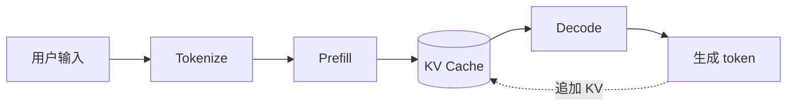

# 把复杂的问题，写得清楚一点

一款适合长时间阅读与写作的主题，应该让内容自然地成为焦点。**Axiom** 用克制的灰阶、舒适的留白和清晰的层级，把熟悉的对话阅读体验带进 Typora。

中文、English、`inline code` 和数学表达 $T = T_{queue} + T_{compute}$ 可以出现在同一行，保持各自的节奏。

## 从一个请求开始

假设一个用户发来请求：“解释一下 KV Cache 的工作方式。”系统先处理输入，再逐个生成输出 token。理解这条数据流，比记住术语更有帮助。

1. **接收输入。** 把文字转换为 token，整理请求的上下文。
2. **执行 Prefill。** 一次处理输入序列，计算并保存每层的 Key 和 Value。
3. **逐步 Decode。** 每生成一个 token，复用已有的 KV，并为新 token 追加缓存。

> KV Cache 保存的是注意力计算中的中间结果。它减少重复计算，同时增加显存占用；具体收益取决于模型、序列长度和服务负载。

### 让代码也保持可读

代码块采用轻灰背景和柔和边框，语言标签保持低调。正文与代码默认均为 **16px**，等宽字体优先使用系统已有的 Cascadia Code 或 Consolas。

```python
from dataclasses import dataclass

@dataclass
class Request:
    prompt_tokens: int
    output_tokens: int

def estimate_kv_bytes(request: Request, layers: int) -> int:
    # 示例：每个 token 的 K/V 占用由模型结构决定
    bytes_per_token = 2 * layers * 8 * 128 * 2
    total_tokens = request.prompt_tokens + request.output_tokens
    return total_tokens * bytes_per_token

request = Request(prompt_tokens=1024, output_tokens=256)
print(f"KV cache: {estimate_kv_bytes(request, 32) / 2**20:.1f} MiB")
```

这里的函数只是计算示例；实际系统还需要考虑块分配、缓存复用与实现细节。你可以使用 `estimate_kv_bytes()` 定位计算逻辑，按 <kbd>Ctrl</kbd> + <kbd>F</kbd> 搜索变量。

## 用合适的结构表达信息

段落适合展开解释，列表适合描述步骤，表格适合比较同一组属性。样式应该帮助读者理解这些区别。

| 维度 | Prefill | Decode |
| :--- | :--- | :--- |
| 处理内容 | 当前输入序列 | 当前生成的 token |
| 缓存操作 | 建立 KV Cache | 读取并追加 KV Cache |
| 常见指标 | 首 token 延迟（TTFT） | 每 token 延迟（TPOT） |

### 一份安静的工作清单

- [x] 建立基础字体与灰阶层级
- [x] 支持中文、英文和代码混排
- [ ] 对真实 Typora 编辑状态进行检查
- [ ] 记录公式、图表与 PDF 导出的验证结果

普通列表也需要清晰的缩进：

- 第一层：读者先看到主要结论。
  - 第二层：补充机制和约束。
    - 第三层：保留必要的技术细节。
- 下一项回到主要叙述，不打断阅读节奏。

## 公式与图示

在简化模型下，KV Cache 的理论数据量可以写成：

$$
M_{KV} = 2 \times L \times N_{KV} \times D_{head} \times S \times B \times b
$$

其中，$L$ 为层数，$N_{KV}$ 为 KV head 数，$D_{head}$ 为每个 head 的维度，$S$ 为序列长度，$B$ 为 batch size，$b$ 为单个元素的字节数。实际分配量还可能包含额外开销。




---

## 留白，是为了更容易继续思考

**好的主题可以退到内容之后。** 标题不需要彩色装饰，引用不需要沉重的底色，代码也不需要模拟一个窗口。你可以把注意力留给问题本身。

这份示例同时作为视觉检查文档。有关主题机制，可参考 [Typora 官方主题开发文档](https://theme.typora.io/doc/Write-Custom-Theme/)。

### 更细的标题层级

#### 四级标题：整理一组细节

这是正文。重点仍然由内容决定，而不是让所有标题都争夺注意力。

##### 五级标题：补充说明

可以使用 ==高亮==、~~删除线~~、上标 X^2^ 与下标 H~2~O。部分扩展语法需要在 Typora 偏好设置中启用。

###### 六级标题：旁注

继续写下去。
